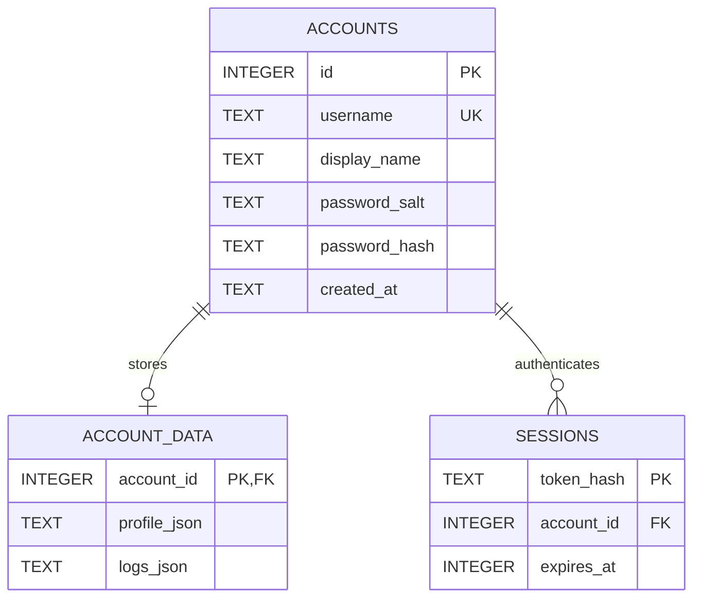

# Hnazer Lifestyle Journal

Hnazer is a local-first lifestyle journaling and self-analysis web application. It lets a user record sleep, exercise, water intake, screen time, mood, diet, and notes, then displays rule-based scores, trends, reminders, and summaries. The project uses React 18, Vite, Tailwind CSS, Chart.js, and a small Node.js service backed by SQLite.

Hnazer does not connect to biometric sensors or produce medically validated diagnoses. All values are entered by the user; health-related labels and recommendations are informational heuristics only.

> College term-end project (2026)
> Developer: Ansh Joshi
> License: MIT is identified by the project; a standalone `LICENSE` file is not currently present.

## Contents

- [Features](#features)
- [Requirements](#requirements)
- [Install And Run](#install-and-run)
- [Accounts And Local Database](#accounts-and-local-database)
- [Using The App](#using-the-app)
- [Daily Record Schema](#daily-record-schema)
- [Scores And Analysis](#scores-and-analysis)
- [Backup, Restore, And Export](#backup-restore-and-export)
- [AI And Privacy](#ai-and-privacy)
- [API Reference](#api-reference)
- [Build And Deployment Notes](#build-and-deployment-notes)
- [Project Structure](#project-structure)
- [Known Limitations](#known-limitations)
- [Troubleshooting](#troubleshooting)

## Features

- **Local accounts:** Create an account with a username, display name, and password. Accounts, profile settings, and logs are kept in a local SQLite database. No email address is required.
- **Per-account records:** Each account has its own profile and daily logs. A new account starts with an empty logbook.
- **Manual daily journaling:** Record sleep, activity, water, screen time, mood, diet, date, and optional notes. Entries can be edited or deleted later.
- **Rule-based analysis:** Calculate per-day metric scores, a weighted vitality score, a recent-record burnout risk summary, and recommendations.
- **Dashboard visualizations:** Review metric panels, a multi-channel timeline, mood distribution, a six-axis score radar, a 35-day heatmap, and record history.
- **Quick hydration logging:** Add 250 ml from the hydration metric, or use the water logger controls to adjust a day's water total.
- **History tools:** Search and filter records, edit or delete entries, export CSV, export a JSON backup, and import JSON logs.
- **AI advisor:** Use the built-in deterministic analysis without sending data to an AI service, or explicitly choose Gemini for an external analysis.
- **Reference library:** Browse in-app learning material about sleep, screen breaks, hydration, and stress management.
- **Print report:** Open the report from the Print Report action in the dashboard dossier and use the browser's print dialog. The browser can save the printed view as PDF.
- **Light and dark themes:** Use the sun/moon control in the top header to switch themes. The choice is saved with the account profile.
- **Settings:** Change the display name, MRN/user ID, daily targets, screen-time ceiling, Gemini API key, and clear the current account's daily logs.

The top navigation intentionally does not contain a demo-data button or a Medical Report button. The print report remains available from the dashboard's dossier area. A 14-day sample generator remains in the source tree for development/reference, but new accounts do not load it automatically and there is no demo-cohort control in the current interface.

## Requirements

- Node.js **22.5 or later**, for the built-in `node:sqlite` API used by the local service.
- npm (ships with Node.js).
- A modern browser with JavaScript and local storage enabled.

The SQLite implementation is a Node built-in module; no native SQLite npm package or separate database server is required.

## Install And Run

Run commands from this project directory (the directory containing `package.json`):

```bash
npm ci
npm run dev
```

Open [http://127.0.0.1:5173](http://127.0.0.1:5173). Keep the terminal process running while using the app. The command starts the account API on `127.0.0.1:3001` and starts Vite on `127.0.0.1:5173`. If Vite's default port is already occupied, Vite may choose the next available port and print it in the terminal.

On first launch, choose **Create account**, enter a display name and username, and create a password of at least eight characters. The account is created only in the database on this computer. On subsequent visits, sign in with that local username and password.

Useful package scripts:

| Command | Purpose |
| --- | --- |
| `npm run dev` | Starts the local SQLite account service and Vite frontend together. |
| `npm run dev:client` | Starts Vite only. It does not start the account API and is not the normal way to use the app. |
| `npm run build` | Creates a production frontend build in the sibling `../site` directory. |
| `npm run preview` | Serves the static production build for visual preview; it does not start the account API. |

There is currently no test, lint, or typecheck script defined in `package.json`.

## Accounts And Local Database

### Registration And Sign-In

- Usernames are trimmed, converted to lowercase, and must contain 3–32 letters, digits, or underscores.
- Display names are trimmed, required, and limited to 80 characters.
- Passwords must be 8–128 characters.
- Usernames are unique on this installation. The same username may exist in a separate database directory.
- There is no email verification, password reset, account recovery, or in-app account deletion flow.
- Registration creates a default profile and an empty log array. Signing in restores that account's saved profile and logs.
- A session lasts 30 days. Signing out invalidates the session token on the local API.

### Database Location And Tables

By default, the database is:

```text
~/.hnazer/accounts.sqlite
```

On Linux, `~` refers to the current user's home directory. The service creates the `~/.hnazer` directory with owner-only permissions (`0700`) and the main database file with owner read/write permissions (`0600`). SQLite write-ahead logging is enabled. Database contents are not encrypted at rest.

The database has three tables:

| Table | Stored information |
| --- | --- |
| `accounts` | Unique username, display name, scrypt password salt/hash, and creation timestamp. |
| `account_data` | One row per account, containing JSON text for the profile and all daily logs. It references `accounts.id` with cascading deletion. |
| `sessions` | SHA-256 hash of a random session token, owning account ID, and expiration timestamp. Expired sessions are removed when the service starts. |

### Entity-Relationship Diagram



Each newly registered account gets one `account_data` row. The profile and logbook are serialized as JSON text in that row; daily logs are not stored as individual relational rows. An account can have multiple active sessions, and deleting an account cascades to its account-data and session rows.

The browser stores only the current session token in local storage under `hnazer_local_account_token_v1`; profile and log data are loaded from and saved to the SQLite API. Passwords are never stored in browser local storage.

### Changing The Data Directory

Set `HNAZER_DATA_DIR` before running the app to use a different folder:

```bash
HNAZER_DATA_DIR="$HOME/my-hnazer-data" npm run dev
```

The app will create/use `accounts.sqlite` inside that directory. Back up the database while the service is stopped, or use the in-app JSON backup for profile and log data. The JSON backup does not include accounts or passwords.

### Local Service Port

The API defaults to port `3001`. `HNAZER_API_PORT` changes the API listener, but the Vite proxy is currently configured to target port `3001` in `vite.config.js`. If changing the API port, update the Vite proxy configuration as well.

## Using The App

### Header

- **Log Biometric Assay:** Opens the daily entry form. On small screens, the compact plus button is shown near the brand; the full action is shown on larger screens.
- **Date selector:** Chooses the date shown by the daily metric panels. The Today action returns to the current date when another date is selected.
- **AI Consultant:** Opens the local/Gemini advisor.
- **Protocols:** Opens the educational reference library.
- **Theme control:** A sun or moon icon switches between light and dark mode. The current preference is saved to the account profile.
- **Settings:** Opens profile, targets, API key, and log-purge controls.
- **Sign out:** Invalidates the current local session and returns to the account screen.

The top header does not include demo-data or report buttons. The report can be opened using **Print Report** in the dashboard dossier.

### Daily Entry

The entry form stores one log per date in the dashboard. It contains:

| Field | Unit / input | Form range or choices |
| --- | --- | --- |
| Date | `YYYY-MM-DD` | Required date input. |
| Sleep | Hours | 0–14, in 0.5-hour steps. |
| Exercise | Hours and minutes | 0–3 hours, in 0.25-hour steps. The UI also displays minutes. |
| Water | Litres | 0–6 litres, in 0.25-litre steps. |
| Screen time | Hours | 0–16 hours, in 0.5-hour steps. |
| Mood | Category | Energized, Good, Neutral, Tired, Stressed, Burnout Alert. |
| Diet | Category | Healthy, Balanced, Average, Fast Food, Irregular. |
| Notes | Free text | Optional personal notes. |

Saving calculates and stores `wellness_score` with the record. Reaching a composite score of 80 or more triggers a small confetti animation. Saving another entry for the same date replaces the previous date's entry.

### Dashboard Sections

1. **Dossier and daily status:** Displays the selected date, profile name/ID, a rule-based triage status, a print-report action, and a few illustrative status readouts.
2. **Vitality overview:** Displays today's selected log scores, recent burnout summary, recommendations, and habit-record counts.
3. **Metric cards:** Shows sleep, exercise, water, screen exposure, mood, and diet for the selected date. The hydration card includes a `+250 ml` action.
4. **Trend and mood charts:** Provides 7-day, 14-day, 30-day, and all-record views for sleep, screen time, and water, plus mood distribution and average values for the selected chart window.
5. **Six-axis radar:** Plots sleep, water, exercise, screen-time, mood, and diet scores on a polygon.
6. **35-day heatmap:** Shows the last 35 dates, color-coded by score. Selecting a day changes the dashboard's selected date.
7. **History manager:** Lists records with score, search by date or notes, mood filtering, edit/delete actions, CSV export, JSON backup/restore, and a new-entry action.

### Quick Hydration

The hydration card in the metric panel adds 0.25 litres to the selected date. The separate water-glass control allows direct adjustment and routes the difference through the same daily log update. If that date has no saved log yet, quick hydration creates one with default values for the other fields.

### Settings

Settings save these profile values:

| Setting | Default | UI range |
| --- | ---: | --- |
| Display name | Account registration name | Required text. |
| MRN / `user_id` | Database account ID | Required number. |
| Target sleep | 8 hours | 4–12 hours, 0.5-hour steps. |
| Target water | 3 litres | 1–8 litres, 0.25-litre steps. |
| Target exercise | 0.75 hours (45 minutes) | 0.25–4 hours, 0.25-hour steps. |
| Maximum screen time | 5 hours | 2–14 hours, 0.5-hour steps. |
| Gemini API key | Empty | Optional password input. |

The **Purge Dossier Ledger** action clears the current account's logs after confirmation. It does not remove the account, password hash, or profile settings.

### Print Report

The dossier's Print Report action opens a summary with averages, triage summary, alerts, recommendations, and up to 10 recent records. **Print Clinical PDF** invokes the browser print dialog; select the browser's save-as-PDF destination to create a PDF. Hnazer does not directly generate or download a PDF file.

## Daily Record Schema

The daily log object uses these fields:

| Property | Type / meaning |
| --- | --- |
| `id` | String record identifier, generally `log_YYYY-MM-DD`. |
| `user_id` | Numeric profile/MRN identifier. |
| `name` | Profile display name copied into the record when saved. |
| `date` | Date string in `YYYY-MM-DD` format; the app uses this to find/replace the day's entry. |
| `sleep_hour` | Sleep duration in hours. |
| `exercise_time` | Exercise duration in hours. |
| `water_intake` | Water intake in litres. |
| `screen_time` | Screen exposure in hours. |
| `mood` | One of the six mood categories. |
| `diet` | One of the five diet categories. |
| `notes` | Optional free text. |
| `wellness_score` | Composite score calculated when the entry is saved. |

The default account profile contains `user_id`, `name`, `target_sleep`, `target_water`, `target_exercise`, `max_screen_time`, `theme`, `ai_provider`, `gemini_api_key`, and `created_at`. Current default targets are 8 hours sleep, 3 litres water, 0.75 hours exercise, and 5 hours maximum screen time. Theme defaults to dark.

## Scores And Analysis

These calculations are implemented in `src/utils/scoring.js`; they are fixed heuristics rather than a clinically validated model.

### Per-Record Metric Scores

Each component score is between 0 and 100 before the weighted composite is computed.

| Metric | Scoring rule |
| --- | --- |
| Sleep | 7–9 h: 100; 6–under 7 h: 80; over 9–10 h: 85; 5–under 6 h: 60; 4–under 5 h: 35; under 4 h: 15; over 10 h: 65. |
| Water | `water_intake / target_water * 100`, rounded and capped at 100. |
| Exercise | `exercise_time / target_exercise * 100`, rounded and capped at 100. |
| Screen | At most 3.5 h: 100; through configured maximum: 85; through max + 2 h: 60; through max + 4 h: 35; higher: 15. |
| Mood | Energized: 100; Good: 85; Neutral: 70; Tired: 45; Stressed: 35; Burnout Alert: 15. |
| Diet | Healthy: 100; Balanced: 85; Average: 65; Fast Food: 40; Irregular: 30. |

Weighted composite:

```text
sleep 25% + exercise 20% + screen 20% + water 15% + mood 10% + diet 10%
```

The result is rounded and clamped to 0–100. The configurable target sleep affects the progress display, but the sleep score itself uses the fixed bands above.

### Recent Burnout Heuristic

The risk calculation uses up to the seven most recent **saved records** (not necessarily seven distinct consecutive calendar dates). Points are accumulated when a condition is met:

| Condition over recent records | Points |
| --- | ---: |
| Average sleep below 6 hours | 30 |
| Average screen time above 7 hours | 25 |
| Average water below 2 litres | 15 |
| Average exercise below 0.3 hours (18 minutes) | 20 |
| At least 3 records marked Tired, Stressed, or Burnout Alert | 20 |

The total is capped at 100. Under 25 points is Low, 25–49 is Moderate, and 50 or more is Critical. The engine also creates text alerts and recommendations for triggered conditions. With no logs, it returns `No Data` plus a prompt to create an entry; averages are not available in that state.

### Streak And Chart Notes

- The displayed streak/active-day helpers currently count qualifying saved records, not strictly consecutive calendar days.
- The chart's water line is scaled by 2.5 to visually compare litres to hour-scale lines; its legend calls this out.
- Heatmap values are per-record composite scores for dates in its 35-day window.
- Missing days are not generated as log records.

## Backup, Restore, And Export

### JSON Backup

The **Backup JSON** action downloads an unencrypted JSON document containing:

- app name and version;
- export timestamp;
- complete profile object;
- current account's log array.

Because the profile includes `gemini_api_key`, a JSON backup can contain that API key. Store the file securely and do not share it without removing sensitive values.

### JSON Restore

**Restore JSON** accepts either a raw array of log records or an object containing a `logs` array. Import replaces the active account's entire log array. It does not restore the profile or targets from the JSON object, and it does not validate individual record fields. Create a backup first if you need to keep the current logbook.

There is no CSV import function.

### CSV Export

CSV export includes these columns:

```text
user_id,name,date,sleep_hour,exercise_time_hours,water_intake_litres,screen_time_hours,mood,diet,notes
```

If there are no saved logs, the CSV export action does nothing. CSV export contains logs only, not account credentials or profile targets.

## AI And Privacy

### Built-In Advisor

The built-in advisor is local JavaScript rule-based analysis. It derives a recent-record summary, displays alerts, and presents a fixed action plan. It does not use a machine-learning model or send records to the account API beyond normal local persistence.

### Optional Gemini Advisor

Gemini is an explicit opt-in path. When run, the browser sends the API key and a prompt to Google's Generative Language API. The prompt includes the profile name, configured targets, and up to seven recent records' dates, sleep, exercise, water, screen time, mood, and diet. It does not include the notes field. The API key is stored in the profile when saved and is included in JSON backups. Use this option only if comfortable sharing those prompt fields with Google under Google's applicable terms and privacy practices.

### Local-First Does Not Mean Air-Gapped

- Account API and SQLite requests stay on loopback (`127.0.0.1`) when the app is used as configured.
- The browser stores the session token in local storage; the SQLite database stores profile/log JSON and account records locally.
- The database is permission-restricted but not encrypted. The OS account protects the files from other unprivileged local users; it is not database encryption.
- `index.html` references Google Fonts, so loading the frontend may make a request to Google's font hosting service.
- The optional Gemini path sends health-related prompt data and the API key to Google.
- Exports are ordinary unencrypted files.

## API Reference

The local Node server accepts JSON requests. Authenticated calls pass `Authorization: Bearer <session-token>`. The token is returned on registration and login; the frontend keeps it in browser local storage.

| Method and path | Authentication | Behavior |
| --- | --- | --- |
| `POST /api/auth/register` | No | Validate and create an account; return account, profile, empty logs, and session token (`201`). |
| `POST /api/auth/login` | No | Verify username/password and return session data (`200`). |
| `GET /api/auth/session` | Bearer token | Restore a current unexpired session (`200`) or return `401`. |
| `POST /api/auth/logout` | Bearer token, if available | Delete the current session and return `{ "ok": true }`. |
| `GET /api/data` | Bearer token | Return the authenticated account's profile and logs. |
| `PUT /api/data` | Bearer token | Replace the account profile and log array. Requires a profile object and logs array. |

All API responses are JSON and sent with `Cache-Control: no-store`. The server rejects request bodies larger than approximately 5 MB. Data writes are scoped to the account associated with the bearer token.

## Build And Deployment Notes

```bash
npm run build
```

Vite writes static frontend assets to `../site` relative to this project directory, normally a sibling `site` directory next to `codes`. The Vite configuration has `emptyOutDir: true`, so a build clears that output directory before writing the new build.

The build is **frontend-only**. It does not package or start the local Node account API. `npm run preview` serves the static files; it is not an account-enabled deployment by itself. For the complete local account experience, run `npm run dev` so both the API and frontend are available.

The development API and Vite server bind to `127.0.0.1`; the Vite `/api` proxy forwards requests to port 3001. Do not expose this server directly to a network or treat this prototype authentication implementation as production internet-facing authentication.

## Project Structure

```text
codes/
|-- index.html                    # HTML entrypoint and page metadata/font links
|-- package.json                  # Dependencies and npm scripts
|-- package-lock.json             # Locked npm dependency graph
|-- vite.config.js                # Loopback Vite server, API proxy, build output
|-- tailwind.config.js            # Tailwind theme/content configuration
|-- postcss.config.js             # Tailwind and Autoprefixer processing
|-- server/
|   `-- index.js                  # SQLite schema, local API, auth and Vite launcher
`-- src/
    |-- main.jsx                  # React root mount
    |-- App.jsx                   # Session gate, dashboard state and orchestration
    |-- index.css                 # Tailwind, themes, panels, animations and print styles
    |-- components/
    |   |-- AccountGate.jsx       # Sign-in and account-creation form
    |   |-- Header.jsx            # Date control, navigation, theme toggle and sign-out
    |   |-- VitalityOverview.jsx  # Composite score, risk and record-count summary
    |   |-- MetricCards.jsx       # Six daily metric summaries and quick hydration
    |   |-- AnalyticsCharts.jsx   # Trends, selected range and mood distribution
    |   |-- BurnoutRadar.jsx      # Six-axis metric score radar
    |   |-- HabitHeatmap.jsx      # 35-date score grid
    |   |-- QuickWaterLogger.jsx  # Water adjustment control
    |   |-- DailyLogModal.jsx     # Create/edit daily record form
    |   |-- HistoryManager.jsx    # Search, filter, edit/delete, JSON/CSV actions
    |   |-- AiAdvisorModal.jsx    # Built-in and Gemini advisor interface
    |   |-- EducationalHub.jsx    # In-app reference topics
    |   |-- ReportModal.jsx       # Print-formatted report
    |   `-- SettingsModal.jsx     # Profile targets, Gemini key and purge control
    `-- utils/
        |-- localAccount.js       # Browser client for local account API/session
        |-- scoring.js            # Daily scoring, risk heuristic and recommendations
        |-- sampleData.js         # Default profile and unused sample data generator
        |-- storage.js            # JSON/CSV export helpers and legacy localStorage helpers
        `-- aiService.js          # Local analysis and Gemini API client
```

## Known Limitations

- The current account flow has no password recovery, account deletion screen, or multi-device synchronization.
- There is no automated test or lint command in the package scripts; the production build is the available compile check.
- The modal components for daily logging, AI advisor, education, and settings currently return before executing hooks when closed. Opening one may cause a React hook-order error; this should be corrected before relying on those workflows.
- The printable report expects diagnostic averages. A new account with no saved records has no averages, so opening the report before creating a record can fail.
- The report contains illustrative/hard-coded demographic and clinical-style labels, including age/sex and pulse-like values. They are not gathered measurements. Browser printing is formatting, not clinical validation or direct PDF generation.
- Some in-app copy calls the storage "air-gapped", "encrypted", "verified", or uses clinical/diagnostic language. Those labels overstate what the implementation guarantees: SQLite contents and JSON exports are not encrypted, the app has not been shown to meet healthcare regulations, and the analysis is heuristic.
- The project README metadata identifies the license as MIT, but the repository currently has no standalone `LICENSE` file. Confirm the intended license text before distributing the project.
- API validation is basic. There is no rate limiting, password recovery, production session hardening, or encryption at rest. The service is intended for one local user/device context and loopback use only.
- Gemini is an external service and Google Fonts are remotely hosted. The application is local-first, but it is not fully network-independent in every configuration.
- The sample data generator and legacy localStorage helpers remain in the source tree but are not part of the active account flow. Newly registered accounts start with an empty logbook.

## Troubleshooting

### `node:sqlite` is unavailable

Install or select Node.js 22.5 or newer, then confirm with:

```bash
node --version
```

### The API port is already occupied

Stop the other local Hnazer instance or process using port 3001. If you choose another port using `HNAZER_API_PORT`, update the `/api` proxy target in `vite.config.js` to the same port before launching Vite.

### Vite chooses a different port

If port 5173 is occupied, Vite reports a different local URL. Open that URL; the API proxy remains available from the Vite server.

### The account sign-in screen cannot connect

Use `npm run dev`, not `npm run dev:client` or `npm run preview`. The Node account service must be running alongside Vite. Check the terminal for the API listening message and the Vite URL.

### Forgot a local password

There is no password reset flow. The app does not store the original password. The database administrator could remove an account and its associated data directly from SQLite, but doing so permanently deletes that account's records. Back up data before making direct database changes.
